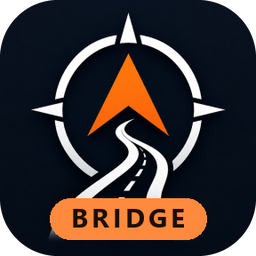
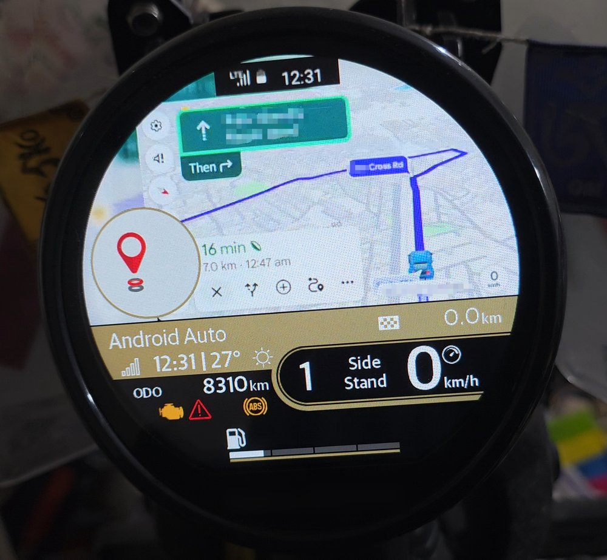
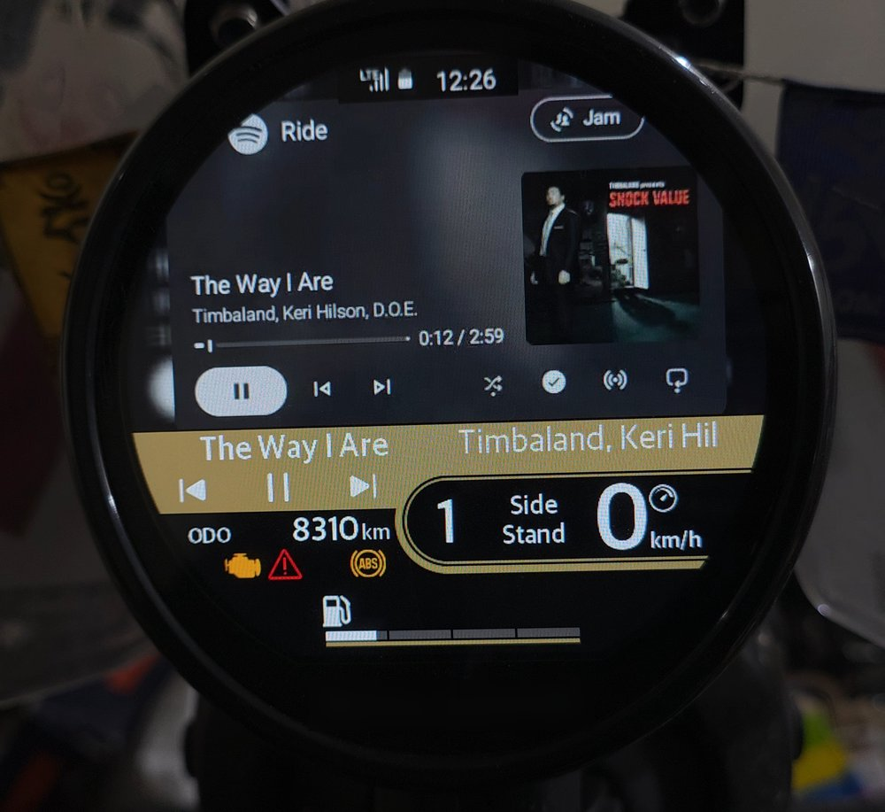
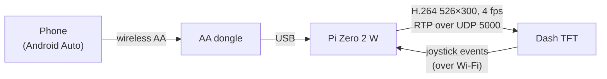

<div align="center">



# WayFindR Pi Bridge

**Android Auto on your motorcycle's round TFT dash, through a ₹2,000 Raspberry Pi.**

[](#hardware)
[](scripts)
[](aa-headless)
[](xbuild)
[](LICENSE)

[Features](#features) •
[How it works](#how-it-works) •
[Getting started](#getting-started) •
[Riding](#riding-with-it) •
[Settings](#settings-reference) •
[Troubleshooting](#logs-and-troubleshooting) •
[Phone-only version](https://github.com/1857rebels/WayFindR-Dash-Bridge)

<br>

<table>
  <tr>
    <td align="center"><br><b>Maps</b></td>
    <td align="center"><br><b>Music</b></td>
  </tr>
</table>

<sub>Photos taken with the phone version, <a href="https://github.com/1857rebels/WayFindR-Dash-Bridge">WFR Dash Bridge</a>. The Pi sends the same kind of picture.</sub>

</div>

---

A Raspberry Pi Zero 2 W turns Android Auto into video for the Mt.Fuji 450's round TFT dash. A
wireless Android Auto dongle on the Pi's USB port connects to the phone. The Pi acts as the car
(head unit), crops and re-encodes Android Auto's screen for the dash, and streams it with
WayFindR's dash protocol. The phone screen stays off, and the joystick on the bike controls Google
Maps and music.

> **No Pi?** [WFR Dash Bridge](https://github.com/1857rebels/WayFindR-Dash-Bridge) does the same
> job as an Android app on the phone itself, using Android Auto's head unit server instead of the
> Pi and dongle.

## Features

- 🗺️ **Google Maps on the dash,** scaled to the round screen with a blurred fill, not black edges.
- 🕹️ **Joystick control:** zoom, re-centre (it finds the button on screen), and music keys.
- 🎵 **Native music widget:** song title, album, artist and play state in the dash's own widget.
- 🔋 **Phone stays cool:** wireless Android Auto to the Pi, phone screen off.
- 🔊 **Audio stays on the phone,** so music and Maps voice keep going to your Bluetooth intercom.
- 🔁 **Self-healing:** the dash session comes and goes with the bike, and a stuck dongle is reset
  automatically.
- 🛟 **Safe on a bike:** survives power cuts, keeps a `.prev` of every file, and has a kill switch
  so you never lose SSH.

## Contents

1. [Hardware](#hardware)
2. [How it works](#how-it-works)
3. [Getting started](#getting-started)
4. [Riding with it](#riding-with-it)
5. [Screen layout and the Dash Map Sizer](#screen-layout-and-the-dash-map-sizer)
6. [Settings reference](#settings-reference)
7. [Test and diagnostic tools](#test-and-diagnostic-tools)
8. [Logs and troubleshooting](#logs-and-troubleshooting)
9. [What we learned about the dash and Android Auto](#what-we-learned-about-the-dash-and-android-auto)
10. [Power cuts and the SD card](#power-cuts-and-the-sd-card)
11. [Roadmap](#roadmap)

## Hardware

| Item | Cost (INR) |
|---|---|
| Raspberry Pi Zero 2 W | ₹2,000 |
| Wireless Android Auto dongle | ₹1,000–2,000 |
| **Total** | **₹3,000–4,000** |

Also needed (prices not recorded): a microSD card, a 12 V → 5 V supply from the bike, a case and
mounting, and cables.

## How it works



| Component | What it does |
|---|---|
| `aa-headless` | Android Auto head unit on aasdk: H.264 800×480 @ 30 fps to stdout, touch/keys from stdin commands, now-playing to log lines. |
| `ffmpeg` | Crop + scale + blur fill + clock strip → 526×300, 4 fps, x264 200 kbps. A second output sends a small strip of the screen at 2 fps, used to find "Re-centre". |
| `dash_bridge` | Session with the dash (auth, nav mode, 1 Hz heartbeat / route card / music), RTP over UDP 5000, joystick events → taps and media keys. |
| `dash_wifi` | Joins the dash hotspot (`RE_*`) when it's in range, otherwise the home Wi-Fi. |

- **Android Auto stays connected all the time** (`AA_ALWAYS=1`). The dash session attaches and
  detaches as the bike's dash comes and goes. While no Android Auto picture is available, the dash
  shows a "Waiting for Android Auto" filler.
- **Audio stays on the phone.** The Pi offers Android Auto only the system-sounds channel, so music
  and Maps voice play over the phone's Bluetooth (the intercom).
- **The dongle gets stuck sometimes.** After a mid-session restart it can fail every session with
  aasdk error 26. The bridge then resets its USB connection (at most once per 120 s), and it
  recovers in about 20 s.

## Getting started

### 1. Build aa-headless

Docker cross-build, about 3 minutes. Building on the Pi takes hours because it has only 415 MB of
RAM. Run from the repo root (Git Bash on Windows):

```bash
docker build -t aa-xbuild:trixie xbuild
```

```bash
MSYS_NO_PATHCONV=1 docker run --rm -v "$(pwd -W):/src" -v aa-xbuild-work:/work aa-xbuild:trixie sh /src/xbuild/build.sh
```

The output is `xbuild/out/aa-headless` plus the `libaasdk*.so*` libraries. openDsh aasdk needs
`FIPS_mode_set` guarded for OpenSSL 3. On Linux or macOS, use `$(pwd)` instead of `$(pwd -W)`.

### 2. Install on the Pi

Copy `scripts/` and the aa-headless folder to the Pi, then:

```bash
sudo sh install.sh /path/to/aa-headless-folder
```

Then set your dash's Wi-Fi password and seat in `/etc/default/wayfindr-pi` (see
[Settings](#settings-reference)).

### 3. Set up the phone

All done once (tested on a Samsung Galaxy S25 Ultra):

| Setting | Where | Value | Why |
|---|---|---|---|
| Driver seat location | Settings → Connected devices → Android Auto → Advanced | **Left** | Moves Maps' turn card, zoom buttons and side bar to the left. Takes effect the next time Android Auto starts. Must match `AA_SEAT`. |
| Guidance audio | Maps on Android Auto → ⚙ Settings | **Alerts only** | Less talking. It's a Maps setting, not a Pi one. |
| Bluetooth audio | Phone | Intercom connected | Music and Maps voice play there; the Pi doesn't take audio. |

### Updating

SSH to the Pi by IP with `-o HostKeyAlias=pizero.local` (`pizero.local` doesn't resolve reliably).
Files go over SSH pipes. To update one file and keep a `.prev` copy:

```bash
ssh -o HostKeyAlias=pizero.local <user>@<pi-ip> 'sudo cp /opt/wayfindr/dash_bridge.py /opt/wayfindr/dash_bridge.py.prev && cat > /tmp/f && sudo install -m 644 /tmp/f /opt/wayfindr/dash_bridge.py && sudo systemctl restart wayfindr-dash-bridge' < scripts/dash_bridge.py
```

For the head unit, use the same command with `/opt/wayfindr/hu/aa-headless`, mode `755`, and
`xbuild/out/aa-headless` as the input.

> [!WARNING]
> **Never lose SSH to the Pi.** Recovering it means reinstalling.
> - The dash Wi-Fi profile has autoconnect off, and the existing Wi-Fi profiles are never touched.
> - **Kill switch:** create the file `/boot/firmware/wayfindr-no-dash` (works from any PC with the
>   SD card) and the Pi never joins the dash.
> - Scripts that stop the bridge must restart it from a `trap`. A cancelled test once left it
>   stopped during a ride.

### Rolling back

Every update leaves the previous file as `.prev` on the Pi: `/opt/wayfindr/dash_bridge.py.prev`,
`/opt/wayfindr/hu/aa-headless.prev` and `/etc/default/wayfindr-pi.prev`. Copy the `.prev` file
over the current one and restart the bridge. Only one previous version is kept.

<details>
<summary><b>Repository layout</b></summary>

| Path | What it is |
|---|---|
| `aa-headless/main.cpp` | Headless Android Auto head unit on openDsh aasdk. Video to stdout, input commands from stdin, now-playing to the log. |
| `aa-headless/CMakeLists.txt` | Its build file. |
| `xbuild/` | Docker cross-build for the Pi (Debian 13 trixie, arm64): `Dockerfile`, `aarch64.cmake`, `build.sh`. The output lands in `xbuild/out/`. |
| `scripts/dash_bridge.py` | The bridge: video pipeline, dash session, joystick, music. Uses the dash protocol module in `scripts/` (framing, auth, heartbeat, route card, music packets). |
| `scripts/dash_wifi.py` | Wi-Fi switching between the dash hotspot and home Wi-Fi. |
| `scripts/wayfindr-pi.default` | Settings template (installed as `/etc/default/wayfindr-pi`). |
| `scripts/wayfindr-dash-bridge.service`, `scripts/wayfindr-dash-wifi.service` | systemd units. |
| `scripts/install.sh` | Installer. |
| `scripts/selftest.py`, `videotest.py`, `latencytest.py`, `live.sh`, `dpisweep.sh`, `inputtest.sh` | Tests and tools, see [below](#test-and-diagnostic-tools). |

On the Pi:

| Path | What it is |
|---|---|
| `/opt/wayfindr/` | The scripts. |
| `/opt/wayfindr/hu/` | `aa-headless` and the aasdk libraries. |
| `/etc/default/wayfindr-pi` | Settings. |
| `*.prev` | The previous version of each file, kept on every update. |

</details>

## Riding with it

### What the dash shows

- **The map:** Android Auto's Maps, scaled to fit the round screen. Around it is a blurred copy of
  the map rather than black.
- **A status strip at the top:** the phone's signal, battery and clock, copied live from Android
  Auto's side bar.
- **The dash's own turn circle at the lower left.** The dash draws it whenever the route card
  carries a turn symbol, and the joystick only works while it does (see
  [findings](#what-we-learned-about-the-dash-and-android-auto)). The layout keeps the important
  parts of the map clear of it.
- **The dash's own music widget:** song title, album and artist, each cut to 19 characters, plus
  playing or paused.

### Joystick

| Dash mode | Press | Dash sends | Pi does |
|---|---|---|---|
| Map | Right | `0x13` | Zoom in (taps Maps' **+** at 204,313) |
| Map | Left | `0x14` | Zoom out (taps **−** at 204,357) |
| Map | Down | `0x15` | Re-centre: taps Maps' **Re-centre** button if it's on screen, otherwise presses AA's Navigation key, which brings Maps back if another app is open |
| Map | Centre | `0x18` | Nothing. The dash switches itself into its music controls. |
| Music | Centre | `0x05` | Play / pause (AA media key 85) |
| Music | Right | `0x09` | Next track (key 87) |
| Music | Left | `0x0A` | Previous track (key 88). The first press restarts the song. |
| Music | Up / Down | `0x06` / `0x07` | Not mapped on the Pi. (The phone app uses them to switch Maps and Music.) |

Tap positions are on Android Auto's own 800×480 screen, before the Pi crops and scales it, so the
dash layout never affects them. They depend only on the driver seat (`AA_SEAT`) and `AA_DPI`.

The **Re-centre** button moves around, so the Pi never taps a fixed spot. ffmpeg sends the bridge
a strip of the screen twice a second, and the bridge taps only where it actually sees the teal
"Re-centre" label (at least 150 matching pixels). A blind tap once opened "Choose driving avatar",
and during a route the ✕ that ends navigation sits next to it.

## Screen layout and the Dash Map Sizer

The **Dash Map Sizer** is an interactive page with real Android Auto frames from the phone, cut the
way the Pi cuts them and masked to the dash's visible circle.

- **Arrange:** drag and resize the map, and move the turn-circle marker with the mouse or the
  arrow buttons and keys. A live list shows which buttons stay visible.
- **Choose the driver seat:** the seat-left and seat-right screens are both there.
- **Apply:** press **Copy for Claude** to copy the values, then set `FILL_LAYOUT`.

Current values (2026-11-01):

| | Value |
|---|---|
| Driver seat | left (`AA_SEAT=left`) |
| What the Pi takes from AA | 504×300 at (176,90) of the 800×480 frame (map + button column, right of the side bar) |
| Map placement | `FILL_LAYOUT=0.876,87,41` (scale, x, y in the 526×300 frame) |
| Right-seat placement (kept) | `0.846,100,49`, taking 500×300 at (120,90) |
| Dash's visible circle | centre (263,257), radius 259, in frame pixels (measured on the bike) |
| Dash's own turn circle | centre (77,228), diameter 139 (reference only, `DASH_TURN_CIRCLE` in the bridge) |
| Clock strip | AA icons 44×18 at (125,102) and clock 52×24 at (121,118), shown 108×26 at the top centre, y 12 |

## Settings reference

Settings live in `/etc/default/wayfindr-pi`. After a change, run:

```bash
sudo systemctl restart wayfindr-dash-bridge
```

<details open>
<summary><b>Dash and Wi-Fi</b></summary>

| Setting | Default | Meaning |
|---|---|---|
| `DASH_PREFIX` | `RE_` | Dash hotspot SSID prefix. |
| `DASH_PSK` | your dash's password | Dash hotspot password. |
| `WIFI_IFACE` | `wlan0` | Wi-Fi interface. |
| `DASH_TITLE` | `Android Auto` | Destination name in the dash's route card. |
| `DASH_HOSTNAME` | `WayfindR` | Name announced to the dash. |
| `DASH_IDLE_CARD` | `turn` | Route card sent while streaming. `turn` is the proven card (depart symbol, joystick works). `nosymbol` or `none` hide the turn circle but kill the joystick. A hex code such as `0x0B` sends that turn symbol (test only). |
| `DASH_STATUS` | `top` | Clock/battery strip in fill mode: `top` or `off`. |
| `DASH_CIRCLE` | `263,257,259` | Visible circle in frame pixels. |
| `DASH_EDGE_INSET` | `6` | Margin kept inside that circle by the automatic layouts. |

</details>

<details>
<summary><b>Picture</b></summary>

| Setting | Default | Meaning |
|---|---|---|
| `VIDEO_MODE` | `fill` | `fill` is the current one: zoom buttons, manual placement. `dome`, `circle` and `full` are older layouts without zoom buttons, which need `AA_DPI=140`. |
| `FILL_LAYOUT` | per seat | `scale,x,y` of the map in fill mode. Empty means the seat's default. |
| `VIDEO_FPS` | `4` | Frames per second to the dash. |
| `VIDEO_BITRATE` | `200k` | The dash's proven rate. Higher rates overran its decoder in WayFindR. |
| `VIDEO_PRESET` | `medium` | x264 preset. `ultrafast` if the Pi ever falls behind. |
| `VIDEO_CROP_BOTTOM` | `72` | Taskbar rows cut off in `circle` and `full` modes. |

</details>

<details>
<summary><b>Android Auto</b></summary>

| Setting | Default | Meaning |
|---|---|---|
| `AA_SEAT` | `right` in code, `left` in the config | Must match the phone's driver seat setting. Picks the crop, clock strip, zoom taps and Re-centre search area. |
| `AA_DPI` | `110` | Screen density told to AA. At 110 or lower Maps shows its zoom buttons; at 120 and above it doesn't. |
| `AA_ALWAYS` | `1` | Keep AA connected even off the dash. With `0`, the dongle restarts every ~14 s off the dash. |
| `AA_AUDIO` | `system` | Audio channels offered to the phone (`media`, `speech`, `system`). Anything left off plays on the phone. |
| `AA_LAUNCH` | `maps` | App opened full screen on connect: `maps`, `media`, `phone` or `none`. |
| `AA_BIN` | `/opt/wayfindr/hu/aa-headless` | The head unit binary. |
| `AA_LEFT_HAND_DRIVE` | unset | Driver side reported to the phone. Has no visible effect; use the phone's setting. |
| `AA_CAR_ID` | unset | Report a different car identity to the phone. Test only. |

</details>

<details>
<summary><b>Joystick</b></summary>

| Setting | Default | Meaning |
|---|---|---|
| `AA_CMD_ZOOM_IN` | `tap 204 313` (right seat: `tap 596 313`) | Command for zoom in. |
| `AA_CMD_ZOOM_OUT` | `tap 204 357` (right seat: `tap 596 357`) | Command for zoom out. |
| `AA_CMD_RECENTRE` | `auto` | `auto` finds the Re-centre button. Any other command is sent as is. |
| `JOY_ZOOM_IN`, `JOY_ZOOM_OUT`, `JOY_RECENTRE` | `0x13`, `0x14`, `0x15` | Dash codes for each action. Space or comma lists are allowed. |
| `JOY_MEDIA_NEXT`, `JOY_MEDIA_PREV`, `JOY_MEDIA_PLAY_PAUSE` | `0x09`, `0x0A`, `0x05` | Dash codes in its music mode. |
| `JOY_DEBOUNCE_MS` | `300` | A different code within this time of the last one is ignored, as a ghost press. |

Commands understood by aa-headless on stdin (also used by `live.sh`), all on AA's 800×480 frame:
- `tap x y`, `doubletap x y`
- `drag x1 y1 x2 y2 [ms]`
- `key code` (Android keycode, or AA button such as 65538 for NAVIGATION)
- `scroll delta`

</details>

## Test and diagnostic tools

Run these on the Pi, in `/opt/wayfindr`, as root. The tests stop the bridge and restart it
afterwards, even if interrupted. Load the settings first with
`set -a; . /etc/default/wayfindr-pi; set +a` and run with `sudo -E`.

| Tool | What it does |
|---|---|
| `selftest.py` | Checks the dash packets against known-good captures. |
| `videotest.py [seconds] [out.h264] ["at:code,…"]` | Runs the whole video path without a dash, captures the RTP and rebuilds the H.264 the dash would get. It can press joystick codes at set times, e.g. `"45:13,52:14,60:15"`. This is how every layout and joystick change was verified. |
| `live.sh` | An interactive AA session. Send commands with `echo "tap x y" \| sudo tee /tmp/aa.in`. A screenshot is saved each second at `/tmp/live/now.png`. It stops after 600 s; end it earlier with `sudo pkill -x aa-headless`. Look before you tap. |
| `latencytest.py` | Times the Pi's decode → filter → x264 path with a synthetic stream: about 390 ms. |
| `dpisweep.sh <margin> dpi…` | Screenshots of AA at several densities, to see which show Maps' zoom buttons. |
| `inputtest.sh "cmd" …` | Tries input commands against Maps and screenshots each. |

To view an H.264 capture, extract a frame:

```bash
ffmpeg -i /tmp/x.h264 -vf "select=eq(n\,100)" -frames:v 1 /tmp/x.png
```

## Logs and troubleshooting

```bash
journalctl -u wayfindr-dash-wifi -u wayfindr-dash-bridge -f
```

The journal is kept in memory, so logs are lost on reboot. Useful lines:
- `dash: button event 0x..` and `joystick: 0x.. -> …`: every dash press and what the Pi did with it.
- `dash: music widget on: <title>`, plus `aa: media: track …` and `aa: media: state …`: now-playing.
- `stats: … sent, … acked, dash backlog …`: video counters every 30 s. With the Pi the dash
  acknowledges only the first frames, so the backlog number isn't meaningful.
- `video: resetting the dongle's USB`: recovery from a stuck dongle. A "reset failed: No such file"
  right after it is harmless (the device re-enumerates).

| Symptom | Cause / fix |
|---|---|
| Dash shows "Waiting for Android Auto" | Is the phone connected to the dongle? Look for `aa:` lines. Error 26 again and again means a stuck dongle; it resets itself, or power-cycle the dongle. |
| Joystick does nothing | Check that `button event` lines arrive. If the dash sends nothing, the route card is probably the no-turn kind (`DASH_IDLE_CARD`). If codes arrive but nothing happens, check that `AA_SEAT` matches the phone. |
| Zoom taps miss | `AA_SEAT`, `AA_DPI` or a Maps update moved the buttons. Re-measure with `live.sh`. |
| Down doesn't re-centre | Re-centre wasn't found (log shows `key 65538`). Check its colour and position with `live.sh` (night mode isn't tested). |
| No SSH | The Pi is on the dash Wi-Fi. Turn off the bike, or use the kill switch. |
| `pkill -f` over ssh kills the ssh session | Use `pkill -x name` or a `[x]yz` pattern. |

## What we learned about the dash and Android Auto

<details>
<summary><b>Dash (firmware 11.63)</b></summary>

- **Joystick needs a turn symbol.** The dash sends map-mode joystick codes (`0x13`/`0x14`/`0x15`)
  only while the 1 Hz route card carries a turn symbol other than "none" (`05 02 ≠ FF`). It then
  always draws its turn circle. Tested with depart `0x3C` (circle, joystick works), `FF` (no
  circle, no joystick) and the invalid `0x0B` (circle, joystick works).
- **Music mode:** centre `0x18` switches the dash into its music controls. There, centre is `0x05`,
  right `0x09` and left `0x0A`.
- **Music widget:** needs `05 17 55` (active) before it shows `05 0D` (title/album/artist) and
  `05 19` (playing `55` / paused `AA`). The Pi sends all three at 1 Hz while something plays.
- **Frame acks:** the dash acks only the first one or two frames from the Pi (`09 06`/`09 04`),
  though the picture keeps updating. WayFindR gets an ack per frame.
- **Visible area:** a circle with centre (263,257) and radius 259 in the 526×300 frame. The dash
  draws its own gold status band below the frame.

</details>

<details>
<summary><b>Android Auto</b></summary>

- **Zoom buttons:** with a 240×180 margin (a 560×300 AA area), Maps shows its zoom buttons only at
  DPI 110 or lower. Injected taps on them work. Taps on the map itself, pinch and pan are ignored,
  and the NAVIGATION key does not re-centre.
- **Driver side:** the side the head unit reports (`left_hand_drive_vehicle`, field 6 =
  driver_position) has no visible effect, even as a new car. The phone's own "Driver seat
  location" setting mirrors the whole layout.
- **Session requirements:** the phone ends the session unless service discovery offers at least
  the system audio sink and the mic source. Offering only `system` audio keeps music and voice on
  the phone.
- **Now-playing:** comes over the media status channel (`media_infoChannel`). The phone repeats the
  play state every second.

</details>

<details>
<summary><b>Latency and picture quality</b></summary>

- **The Pi:** its pipeline holds a frame for about 390 ms. A select-based frame picker saved only
  about 65 ms and needed `-fps_mode passthrough` plus a pinned SPS, so it was dropped.
- **The rest:** the few seconds of lag seen on rides is most likely the dash's own queue. It's not
  yet measurable, because the acks don't arrive.

Picture quality, measured on a scrolling navigation frame (SSIM):

| Setting | SSIM |
|---|---|
| Now: 200 kbps, a keyframe every 1 s | 0.966 |
| Keyframe every 2 s | 0.975 |
| 300 kbps | 0.983 |
| Both | 0.988 |

Neither change has been tried on the dash. A 720p AA stream would cost about +25% of a core to
decode.

</details>

## Power cuts and the SD card

Cutting the Pi's power without a shutdown is normal on the bike and mostly safe:
- **Software:** the bridge keeps no state.
- **Writes:** the journal and test files live in memory (`/tmp` is expected to be tmpfs).
- **Filesystem:** ext4 repairs itself after most cuts.
- **Remaining risk:** a write in progress, which is rare while riding. Never cut power during an
  update.

## Roadmap

- [x] Headless Android Auto head unit, cross-built for the Pi
- [x] Video to the dash, joystick zoom and re-centre
- [x] Dash music widget and media keys
- [x] Automatic dash / home Wi-Fi switching and dongle recovery
- [ ] Turn off automatic apt updates and audit other writes
- [ ] Read-only SD card (`raspi-config` overlay file system) once the setup stops changing
- [ ] Keep an image of the SD card

**Not yet verified on the bike:**
- Song title and play state on the dash's music widget (sent, not seen).
- Re-centre while browsing (no route) and in Maps' night theme.
- The current layout `0.876,87,41`.
- A 2 s keyframe interval or 300 kbps.
- Whether the dash's lag comes from its own queue.

## Related projects

- [**WayFindR**](https://github.com/1857rebels/WayFindR): the full companion app, with its own
  navigation drawn for the dash, plus maintenance and fuel logs.
- [**WFR Dash Bridge**](https://github.com/1857rebels/WayFindR-Dash-Bridge): this bridge as an
  Android app on the phone, with no Pi or dongle.

## Acknowledgements

- [openDsh aasdk](https://github.com/openDsh/aasdk): the Android Auto head unit library that
  `aa-headless` is built on.
- [better-dash](https://github.com/norbertFeron/better-dash): the starting point for the dash
  protocol.
- [FFmpeg](https://ffmpeg.org/) and [x264](https://www.videolan.org/developers/x264.html): the
  video pipeline.

## Disclaimer

This is an unofficial hobby project. It isn't affiliated with or endorsed by the motorcycle's maker
or by Google. Keep your eyes on the road: set things up before you ride.

## License

[MIT](LICENSE)
